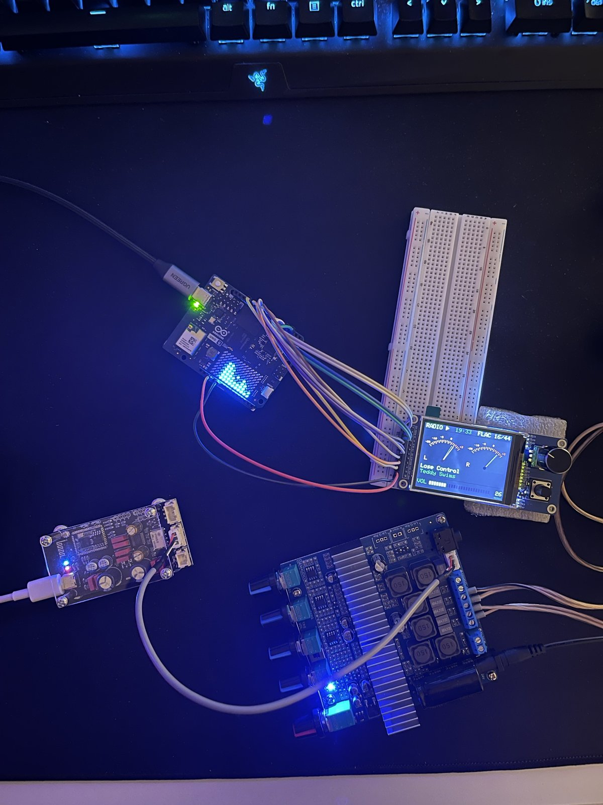

# MPD Spectrum Analyzer and Remote for Arduino UNO Q



A spectrum analyzer and a physical remote for [MPD](https://www.musicpd.org)
on the [Arduino UNO Q](https://www.arduino.cc/product-uno-q), driven by
whatever MPD is playing — CDs, FLAC/WAV files, CUE images or internet radio.

**LED matrix** (built in, 8×13)
- 13 log-spaced bands from 40 Hz to 16 kHz (bass on the left)
- Bars with fast attack and smooth fall, peak dots that hold ~0.5 s

**2.4" TFT + rotary encoder** (optional)
- Now playing: artist, title, album, year, track, time, format (`FLAC 16/44`, `MP3 320`)
- Three more views: a 32-band tape-deck spectrum with peak hold, two VU meters, a
  6E1P-style magic eye
- Knob: volume; press: play/pause; hold: next track (repeats every second)
- Menu: queue, artists, albums, internet radio, audio CD, the USB stick with CD rips
  (CD and USB are greyed out while the drive or the stick is not plugged in)
- Settings menu: screen brightness, 16 or 32 spectrum bars, peaks that fade or
  fall, when the rain starts, LED matrix brightness, sensitivity, start view
- Latin and Cyrillic titles; long titles scroll back and forth
- After a minute without playback: the "digital rain"

Everything runs on the board itself; it never affects playback — if the app
stops, MPD keeps playing.

## How it works

```
MPD ──► main audio output (DAC) ──► amplifier
 │  ▲
 │  └── commands (volume, play, next, menu) ──────────┐
 └──► FIFO output (44.1 kHz / 16-bit / stereo)         │
         │                                             │
         ▼                                             │
   python/main.py + mpdui.py  (Linux side, App Lab container)
   PCM → FFT → 13 + 16 band levels, L/R VU             │
   MPD idle → what is playing, volume, clock           │
         │  Bridge.notify(...)          ▲ Bridge.notify(vol / cmd / get / sel)
         ▼                              │
   sketch/sketch.ino  (STM32 MCU)
   LED matrix · TFT screens · knob and buttons
```

MPD writes a copy of the decoded audio into a named pipe. Its format is fixed
in `mpd.conf`, so every source (hi-res FLAC, MP3 radio, mono) arrives in the
same 44.1 kHz / 16-bit / stereo format, while the main output still gets the
original stream. The volume mixer only affects the main output, so the
analyzer looks the same at any volume.

The App Lab Python app runs inside a Docker container that only sees the app
folder (mounted at `/app`), so the FIFO is placed inside the app folder. MPD
runs on the host; the container reaches it through its default gateway.

The MCU draws everything; Python only sends data. Bridge callbacks run in a
separate thread on the MCU, so they just copy messages into an inbox and
`loop()` draws them. One Bridge message holds at most 256 bytes, so menu
lists travel one row per message, a page (8 rows) at a time.

## Requirements

- Arduino UNO Q with Arduino App Lab
- MPD running on the board (`sudo apt install mpd mpc`), listening on all
  interfaces (`bind_to_address "any"` in `/etc/mpd.conf`)
- For the remote: a 2.4" ST7789 320×240 SPI TFT and an EC11 rotary encoder
  with push button, plus one extra button (K0). Modules that combine all three
  exist; that is what this was built with.

## Wiring (remote)

UNO Q GPIO is 3.3 V: power the module from **3.3V**, not 5V.

In the order of the module's header (wire colours as in the photo):

| Module | UNO Q | Wire |
|---|---|---|
| GND | GND | black |
| VCC | 3.3V | red |
| SCL | D13 | yellow |
| SDA | D11 | orange |
| RES | D9 | white |
| DC | D8 | grey |
| CS | D10 | purple |
| BLK (backlight) | D6 | brown |
| A (encoder) | D2 | green |
| B (encoder) | D3 | blue |
| PUSH (encoder button) | D4 | white |
| K0 (button) | D5 | grey |

RES/DC/CS are not in pin order (D9, D8, D10): the easiest place to cross two
wires. With RES and DC swapped the screen stays dark.

Without the module the app still works: the matrix shows the spectrum and
the sketch simply has nothing to draw on.

## Setup

### 1. Get the app onto the board

Clone this repository into the App Lab apps folder on the board:

```sh
cd ~/ArduinoApps
git clone https://github.com/VitaliBorys/uno-q-mpd-spectrum.git spectrum
```

Updates later: `git pull` in that folder, then **Run** in App Lab.

### 2. Create the FIFO

```sh
mkdir -p ~/ArduinoApps/spectrum/viz
mkfifo ~/ArduinoApps/spectrum/viz/mpd.fifo
chmod 666 ~/ArduinoApps/spectrum/viz/mpd.fifo
```

MPD runs as its own user, so it needs to be able to traverse into the folder.
The default permissions of `/home/arduino` (`drwxr-xr-x`) allow this. Also
check that the MPD service does not set `ProtectHome=`:

```sh
systemctl cat mpd | grep -i protect
```

### 3. Add the FIFO output to MPD

Append to `/etc/mpd.conf`:

```
audio_output {
    type    "fifo"
    name    "visualizer"
    path    "/home/arduino/ArduinoApps/spectrum/viz/mpd.fifo"
    format  "44100:16:2"
}
```

Then restart MPD and check that both outputs are enabled:

```sh
sudo systemctl restart mpd
mpc outputs
```

Quick test while music is playing (should be roughly 350–400 KB):

```sh
timeout 2 cat ~/ArduinoApps/spectrum/viz/mpd.fifo > /tmp/fifo_test.raw
ls -l /tmp/fifo_test.raw
```

### 4. Radio stations (optional)

Edit `radio.txt` in the app folder: one station per line, `Name | stream URL`.
The names show up in the Radio menu and on the screen. Radio Paradise's
`flacm` streams carry the song titles, so the screen shows artist and title.

### 5. Run

Open the `spectrum` app in Arduino App Lab and press **Run**. The first start
installs numpy and tzdata and takes a minute or two.

After changing files, restart with **Run**, not `docker restart`: restarting
only the Python container leaves the Bridge routing the MCU's messages to the
old connection, so the knob and buttons stop reaching Python.

## Controls

| | Views | Menu |
|---|---|---|
| Turn | Volume | Move |
| Press + turn | Next / previous view | Jump a page |
| Press (< 1 s) | Play / pause | Open, or play (an album or station replaces the queue) |
| Hold (1 s) | Next track, again every second | Add to the end of the queue |
| K0 | Open the menu | Back |

Any input wakes the screen from the digital rain without doing anything else.

## Tuning

The everyday ones are in the **Settings** menu (press a row, turn to change it,
press to keep, K0 to undo). Python saves them in `settings.json` in the app
folder (not in git).

Settings menu | Values
---|---
Brightness | 10–100 %
Spectrum | 16 or 32 bars
Peaks | fade in place or fall
Rain after | never, 1, 2, 5, 10, 30 min without playback
Matrix | LED matrix brightness 1–7
Sensitivity | −36 … −60 dB: the level shown as an empty bar (further from 0 = taller bars)
Start view | Now, Spectrum, VU, Eye, or the last one used
Menu cursor | slides or fades between rows

The rest are constants at the top of `python/main.py`:

| Setting | Default | Effect |
|---|---|---|
| `FPS` | `25` | Analyses (lv messages) per second |
| `VU_REF_DBFS` | `-18.0` | Level that reads 0 VU on the meters |
| `PROFILE` | `False` | Print per-stage timings (read, FFT, bridge) every 5 s |

`python/mpdui.py`: `TIMEZONE` (the container runs in UTC), `VOLUME_STEP`
(percent per click, keep it equal to the sketch's).

`sketch/sketch.ino`: the LED matrix bars (`MAT_FALL` rows per second,
`MAT_PEAK_HOLD_MS`, `MAT_PEAK_FALL`, `MAT_BAR_BRIGHT` / `MAT_PEAK_BRIGHT`
0..7), `FRAME_MS` (TFT animation, 16 = ~60 fps), `FAST_SPI` /
`FAST_SPI_DIV` (see below), `REVERSE` (knob direction), `STEPS_PER_DETENT`,
`HOLD_MS` / `REPEAT_MS` (hold to skip),
`MQ_PX` / `MQ_STEP_MS` / `MQ_HOLD_MS` (scrolling titles), `SHOW_MS` (redraw
time in the corner).

## Notes on the display

The SPI driver of the Zephyr core works without DMA, with an interrupt per
word, and moves only 300–500 KB/s whatever the clock: a full-screen redraw
takes ~0.45 s. With `FAST_SPI` (the default) the sketch writes SPI2's
registers itself while it draws, at 40 MHz, and gives the SPI back to the
driver as it found it afterwards: a full screen then takes ~47 ms. Measure
it on your board with `tools/spi-bench` (a separate App Lab app: copy the
folder to `~/ArduinoApps/spi-bench`). If the picture shows garbage, set
`FAST_SPI_DIV = 8` (20 MHz) or `FAST_SPI = false`.

The sketch also never redraws more than it has to: only changed bar
segments, needles and text, text rendered in RAM and sent as one block, and
on a view change only what the old view drew is erased. Switching views
takes ~35 ms; animations run at ~60 fps.

## Limitations

- Only audio played through MPD is shown. Bluetooth audio going straight to a
  DAC, or players like Spotify Connect / AirPlay that output to ALSA directly,
  bypass the FIFO.
- The FIFO is fed slightly ahead of what you hear because of the DAC's output
  buffer. In practice the offset is small.
- Characters other than Latin and Cyrillic show as `?` on the TFT.

## Project layout

```
python/main.py           audio capture, FFT, band levels for the matrix and the TFT
python/mpdui.py          MPD client: now playing, knob and buttons, menu lists
python/requirements.txt  Python dependencies (numpy, tzdata)
sketch/sketch.ino        LED matrix, TFT screens, encoder and buttons
sketch/font5x7*.h        5×7 pixel font: Latin (Adafruit), Cyrillic, rain glyphs
tools/cdrom-modules/     builds the CD drivers the UNO Q kernel leaves out
tools/spi-bench/         TFT fill speed: Zephyr's SPI driver vs. direct registers
radio.txt                internet radio stations for the menu
```

## License

MIT. The Latin 5×7 font is from Adafruit GFX (BSD license).
